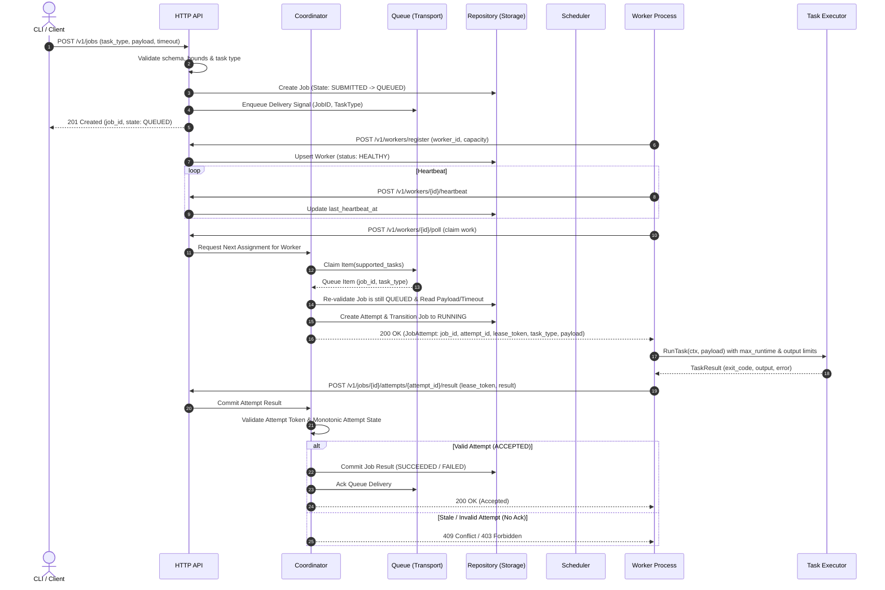

# MiniCloud Architecture Specification

## 1. System Mission and Philosophy
MiniCloud is a distributed job execution platform designed to make state transitions, worker coordination, failure handling, and recovery semantics clear, testable, and measurable.

The architecture emphasizes:
- **Correctness before scale:** Strict state invariants and clear consistency models take precedence over throughput.
- **Modular monolith control plane:** Component boundaries are defined by Go interfaces without premature microservice decomposition.
- **Separation of concerns:** Business rules are isolated from transport, storage, and execution technologies.

---

## 2. Logical Components and Ownership Boundaries

Each component has strictly defined responsibilities and explicit negative constraints ("Must NOT Own"):

| Component | Package / Path | Responsibilities | Must NOT Own |
|---|---|---|---|
| **CLI** | `cmd/mc` | Submit jobs, query status/attempts, list workers, request cancellation. Formats output for humans/scripts. | Scheduling logic or direct storage/DB access. |
| **HTTP API** | `internal/api` | Request validation, payload size limits, HTTP contract mapping, response serialization, route handling. | Long-running task execution or background recovery loops. |
| **Coordinator** | `internal/coordinator` | Orchestration, lifecycle transition coordination, dispatch management, lease verification, recovery scan. | Direct user workload execution. |
| **Scheduler** | `internal/scheduler` | Evaluates worker health and capacity, selects worker by policy (deterministic round-robin baseline). | Authoritative truth about job states or storage mutations. |
| **Worker Agent** | `cmd/worker`, `internal/worker` | Independent OS process: registers, sends periodic heartbeats, polls/claims work, invokes executor, reports result. | Global authoritative job state or direct database access. |
| **Executor** | `internal/executor` | Executes approved allowlisted tasks (`echo`, `sleep`, `sha256_loop`), enforces execution timeouts and output caps. | Scheduling decisions or worker registration logic. |
| **Storage** | `internal/storage` | Repository interface and concurrent-safe storage abstraction (in-memory for Milestone 1; PostgreSQL in Phase 3). | Transient queue delivery mechanics. |
| **Queue / Transport** | `internal/queue` | Dispatch transport abstraction (in-memory channel/poll in Milestone 1; Redis Streams in Phase 5). | The only copy of accepted job state. |
| **Observability** | `internal/observability` | Structured logging (`log/slog`) with correlated `job_id`, `attempt_id`, and metrics. | Business state authority or control plane decisions. |

---

## 3. Package Structure and Boundaries

```text
minicloud/
├── cmd/
│   ├── coordinator/        # Coordinator daemon entry point
│   ├── worker/             # Worker process entry point
│   └── mc/                 # Operator/Developer CLI
├── internal/
│   ├── domain/             # Core entities (Job, Attempt, Worker), states, transition rules (no external deps)
│   ├── storage/            # Repository interface & in-memory implementation (PostgreSQL in Phase 3)
│   ├── queue/              # Dispatch transport interface & in-memory queue (Redis Streams in V2)
│   ├── executor/           # Task interface, allowlist registry (echo, sleep, sha256_loop), resource limits
│   ├── scheduler/          # Scheduler interface & deterministic round-robin implementation
│   ├── coordinator/        # Orchestrator coordinating storage, scheduling, queue, and attempt tracking
│   ├── api/                # net/http server, routes, request validation, structured error responses
│   ├── worker/             # Worker agent client loop: register, heartbeat, poll/claim, execute, report
│   └── config/             # Environment variable parsing and startup validation
├── tests/
│   ├── architecture/       # Package boundary and dependency invariant tests
│   └── integration/        # End-to-end integration tests with multiple processes
└── docs/                   # Architecture, state machine, protocol, ADRs
```

### Architecture Rule on Domain Independence
`internal/domain` must remain completely independent of:
- `net/http` or web frameworks
- Database drivers (`database/sql`, `pgx`)
- Transport systems (Redis, gRPC)
- Container runtimes (Docker)

All state transitions, attempt validations, and invariant checks live in `internal/domain` and are tested with fast, pure Go unit tests.

---

## 4. End-to-End Data Flow



---

## 5. Deployment Progression
- **Stage A (Milestone 1):** In-process storage, single coordinator, 2+ independent worker processes on one host over HTTP.
- **Stage B (Milestone 2 - Current):** Enhanced independent worker lifecycle, heartbeats, worker liveness/reaper, and dispatch-transport queue interface.
- **Stage C (Phase 3):** PostgreSQL durable storage and restart recovery.
- **Stage D (Phase 4):** Leases, timeouts, and automatic retry/requeue failure recovery.
- **Stage E (Phase 6 / V2):** Redis Streams dispatch transport evaluation against PostgreSQL baseline (ADR-0006).
- **Stage F (V3):** Docker executor isolation with CPU/memory/PID limits (ADR-0005) and multi-machine network deployment with mutual TLS.
