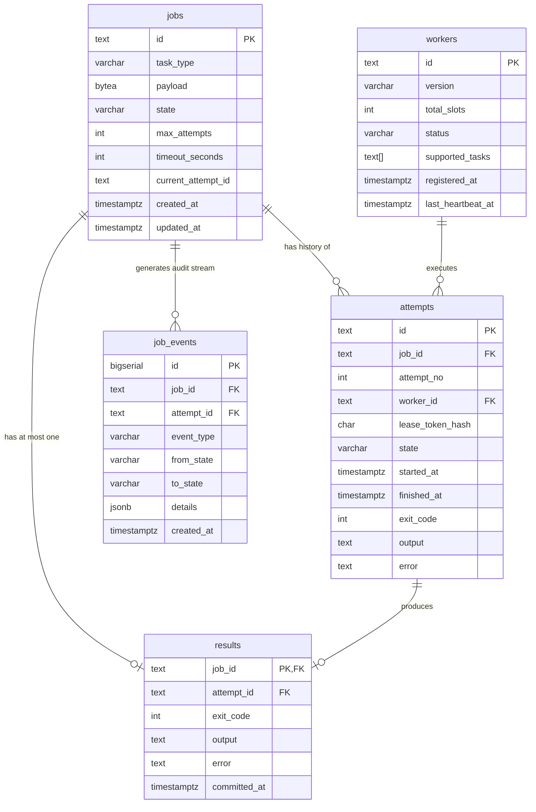

# MiniCloud PostgreSQL Database Schema Specification

## 1. Overview & Architectural Role

In MiniCloud V1 Phase 3, PostgreSQL serves as the authoritative, durable system of record for all jobs, execution attempts, registered workers, execution results, and lifecycle audit events.

### Core Database Design Principles
1. **Invariants Enforced in SQL:** Rather than relying exclusively on application memory checks, critical distributed system invariants (such as at most one active attempt per job, single terminal result, and non-overlapping attempt numbers) are enforced by database schema constraints and partial unique indexes.
2. **Bounded Row Storage:** In accordance with MiniCloud's bounded resource invariant, all variable-length fields (`payload`, `output`, `error`) have explicit `CHECK` constraints enforcing hard length limits. Unbounded blobs (`TEXT` or `BYTEA` without length checks) are strictly prohibited.
3. **Database Clock Authority & Transaction Timestamp Semantics:**
   - In PostgreSQL, `now()` and `CURRENT_TIMESTAMP` return the **start time of the current transaction**, which remains frozen across all statements within that transaction block.
   - Where sub-statement execution freshness inside a multi-statement transaction matters (e.g., audit event recording or precise dispatch duration logging), the schema and queries use **`clock_timestamp()`**.
   - All lease tracking, heartbeat evaluations, and timeout checks stay strictly on database time. Clock drift between worker nodes or coordinator processes cannot corrupt lease or heartbeat validity.
4. **Dynamic Capacity Derivation (No Counter Drift):** Storing mutable integer counters (`available_slots`) that are incremented on commit and decremented on dispatch is vulnerable to counter drift during coordinator crashes, dropped connections, or worker reaps. MiniCloud derives available capacity directly from active running attempts in SQL.
5. **Audit Immutability:** Execution attempts, audit events, and committed results are append-only. Foreign keys prevent accidental orphaned data or cascading deletions during normal operations.

---

## 2. Entity-Relationship Model



---

## 3. Detailed Table Definitions & SQL DDL

### 3.1 Table: `jobs`
The root entity representing submitted computational work.

```sql
CREATE TABLE jobs (
    id TEXT PRIMARY KEY,
    task_type VARCHAR(64) NOT NULL,
    payload BYTEA NOT NULL,
    state VARCHAR(32) NOT NULL,
    max_attempts INTEGER NOT NULL DEFAULT 3,
    timeout_seconds INTEGER NOT NULL DEFAULT 60,
    current_attempt_id TEXT,
    created_at TIMESTAMPTZ NOT NULL DEFAULT CURRENT_TIMESTAMP,
    updated_at TIMESTAMPTZ NOT NULL DEFAULT CURRENT_TIMESTAMP,

    -- Size bounds (Invariant: bounded payload 64 KiB)
    CONSTRAINT chk_jobs_payload_size 
        CHECK (octet_length(payload) <= 65536),

    -- Valid FSM states
    CONSTRAINT chk_jobs_state 
        CHECK (state IN (
            'SUBMITTED', 'QUEUED', 'RUNNING', 
            'CANCEL_REQUESTED', 'CANCELLED', 
            'SUCCEEDED', 'FAILED', 'RETRYING', 'DEAD_LETTER'
        )),

    -- Logical constraints
    CONSTRAINT chk_jobs_max_attempts 
        CHECK (max_attempts > 0 AND max_attempts <= 20),
    CONSTRAINT chk_jobs_timeout 
        CHECK (timeout_seconds > 0 AND timeout_seconds <= 86400)
);

-- Indexes for dispatch and querying
CREATE INDEX idx_jobs_dispatch 
    ON jobs (created_at ASC) 
    WHERE state = 'QUEUED';

CREATE INDEX idx_jobs_task_dispatch 
    ON jobs (task_type, created_at ASC) 
    WHERE state = 'QUEUED';

CREATE INDEX idx_jobs_created_at 
    ON jobs (created_at DESC);
```

### 3.2 Table: `workers` & Dynamic Capacity View
Tracks registered worker processes and static capacity.

```sql
CREATE TABLE workers (
    id TEXT PRIMARY KEY,
    version VARCHAR(64) NOT NULL,
    total_slots INTEGER NOT NULL,
    status VARCHAR(32) NOT NULL,
    supported_tasks TEXT[] NOT NULL,
    registered_at TIMESTAMPTZ NOT NULL DEFAULT CURRENT_TIMESTAMP,
    last_heartbeat_at TIMESTAMPTZ NOT NULL DEFAULT CURRENT_TIMESTAMP,

    CONSTRAINT chk_workers_slots 
        CHECK (total_slots > 0),
    CONSTRAINT chk_workers_status 
        CHECK (status IN ('HEALTHY', 'UNHEALTHY', 'DRAINING', 'TERMINATED'))
);

-- Index for background reaper sweep
CREATE INDEX idx_workers_liveness 
    ON workers (last_heartbeat_at ASC) 
    WHERE status = 'HEALTHY';

-- Dynamic Capacity View: Derives available slots from active RUNNING attempts
-- Eliminates counter drift caused by coordinator crashes, transaction rollbacks, or dead workers.
CREATE VIEW worker_capacity AS
SELECT 
    w.id,
    w.version,
    w.total_slots,
    w.status,
    w.supported_tasks,
    w.registered_at,
    w.last_heartbeat_at,
    GREATEST(0, w.total_slots - COUNT(a.id) FILTER (WHERE a.state = 'RUNNING'))::integer AS available_slots
FROM workers w
LEFT JOIN attempts a ON a.worker_id = w.id
GROUP BY w.id;
```

### 3.3 Table: `attempts`
Represents an individual execution attempt assigned to a worker under a specific lease.

```sql
CREATE TABLE attempts (
    id TEXT PRIMARY KEY,
    job_id TEXT NOT NULL REFERENCES jobs(id) ON DELETE RESTRICT,
    attempt_no INTEGER NOT NULL,
    worker_id TEXT NOT NULL REFERENCES workers(id) ON DELETE RESTRICT,
    lease_token_hash CHAR(64) NOT NULL,
    state VARCHAR(32) NOT NULL,
    started_at TIMESTAMPTZ NOT NULL DEFAULT CURRENT_TIMESTAMP,
    finished_at TIMESTAMPTZ,
    exit_code INTEGER,
    output TEXT,
    error TEXT,

    -- Monotonic attempt numbering per job
    CONSTRAINT chk_attempts_attempt_no 
        CHECK (attempt_no > 0),

    -- Distinct attempt sequence per job
    CONSTRAINT uq_attempts_job_attempt_no 
        UNIQUE (job_id, attempt_no),

    -- Valid attempt states
    CONSTRAINT chk_attempts_state 
        CHECK (state IN ('PENDING', 'RUNNING', 'COMPLETED', 'FAILED', 'TIMED_OUT', 'CANCELLED', 'LOST')),

    -- Bounded output and error size (Invariant: bounded output 64 KiB, error 10 KiB)
    CONSTRAINT chk_attempts_output_size 
        CHECK (output IS NULL OR octet_length(output) <= 65536),
    CONSTRAINT chk_attempts_error_size 
        CHECK (error IS NULL OR octet_length(error) <= 10240)
);

-- CRITICAL DISTRIBUTED INVARIANT: At most one active (RUNNING) attempt per job
CREATE UNIQUE INDEX idx_attempts_active_per_job 
    ON attempts (job_id) 
    WHERE state = 'RUNNING';

CREATE INDEX idx_attempts_job_id 
    ON attempts (job_id, attempt_no ASC);

CREATE INDEX idx_attempts_worker_liveness 
    ON attempts (worker_id, state);
```

### 3.4 Table: `results`
Holds the definitive, final committed outcome for a completed or failed job.

```sql
CREATE TABLE results (
    job_id TEXT PRIMARY KEY REFERENCES jobs(id) ON DELETE RESTRICT,
    attempt_id TEXT NOT NULL REFERENCES attempts(id) ON DELETE RESTRICT,
    exit_code INTEGER NOT NULL,
    output TEXT NOT NULL,
    error TEXT NOT NULL,
    committed_at TIMESTAMPTZ NOT NULL DEFAULT CURRENT_TIMESTAMP,

    -- Bounded output and error size
    CONSTRAINT chk_results_output_size 
        CHECK (octet_length(output) <= 65536),
    CONSTRAINT chk_results_error_size 
        CHECK (octet_length(error) <= 10240)
);

CREATE INDEX idx_results_committed_at 
    ON results (committed_at DESC);
```

### 3.5 Table: `job_events`
Immutable, append-only lifecycle event stream for auditing and debugging.

```sql
CREATE TABLE job_events (
    id BIGSERIAL PRIMARY KEY,
    job_id TEXT NOT NULL REFERENCES jobs(id) ON DELETE CASCADE,
    attempt_id TEXT REFERENCES attempts(id) ON DELETE SET NULL,
    event_type VARCHAR(64) NOT NULL,
    from_state VARCHAR(32),
    to_state VARCHAR(32),
    details JSONB NOT NULL DEFAULT '{}'::jsonb,
    created_at TIMESTAMPTZ NOT NULL DEFAULT clock_timestamp()
);

CREATE INDEX idx_job_events_job_timeline 
    ON job_events (job_id, created_at ASC);

CREATE INDEX idx_job_events_type 
    ON job_events (event_type, created_at DESC);
```

---

## 4. Invariants Enforced Directly in SQL

| Invariant | Implementation in Schema | Violation Behavior |
|---|---|---|
| **At most one active attempt per job** | `CREATE UNIQUE INDEX idx_attempts_active_per_job ON attempts (job_id) WHERE state = 'RUNNING';` | Database rejects concurrent dispatch with `SQLSTATE 23505` (unique constraint violation). |
| **No Capacity Counter Drift** | `worker_capacity` view deriving `available_slots = total_slots - count(attempts WHERE state = 'RUNNING')`. | Capacity is physically derived from active attempts; zero counter drift across restarts or crashes. |
| **Exactly one committed result per job** | `PRIMARY KEY (job_id)` on `results` table with foreign key to `jobs(id)`. | Stale or duplicate commits fail immediately at the database layer. |
| **Monotonically unique attempt numbers** | `CONSTRAINT uq_attempts_job_attempt_no UNIQUE (job_id, attempt_no)`. | Attempt numbers for a job can never duplicate or collide. |
| **Bounded Payload (64 KiB)** | `CHECK (octet_length(payload) <= 65536)`. | Rejects oversized payloads at SQL insert time. |
| **Bounded Output (64 KiB)** | `CHECK (octet_length(output) <= 65536)`. | Prevents rogue worker output buffer exhaustion in storage. |
| **Bounded Error Summary (10 KiB)** | `CHECK (octet_length(error) <= 10240)`. | Prevents massive stack traces or core dumps from ballooning database size. |
| **Database-Authoritative Timestamps** | `CURRENT_TIMESTAMP` for transaction boundaries; `clock_timestamp()` for event sequencing. | Eliminates worker/coordinator clock skew vulnerability. |
| **Token Privacy** | `lease_token_hash CHAR(64)` storing SHA-256 digest. | Database dumps never reveal live bearer credentials. |
